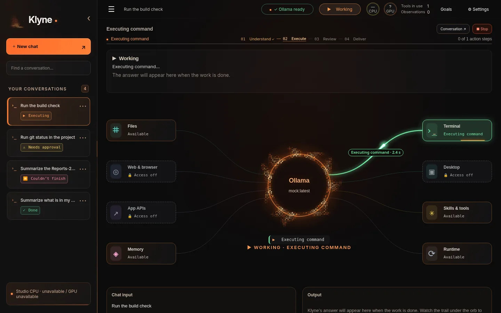
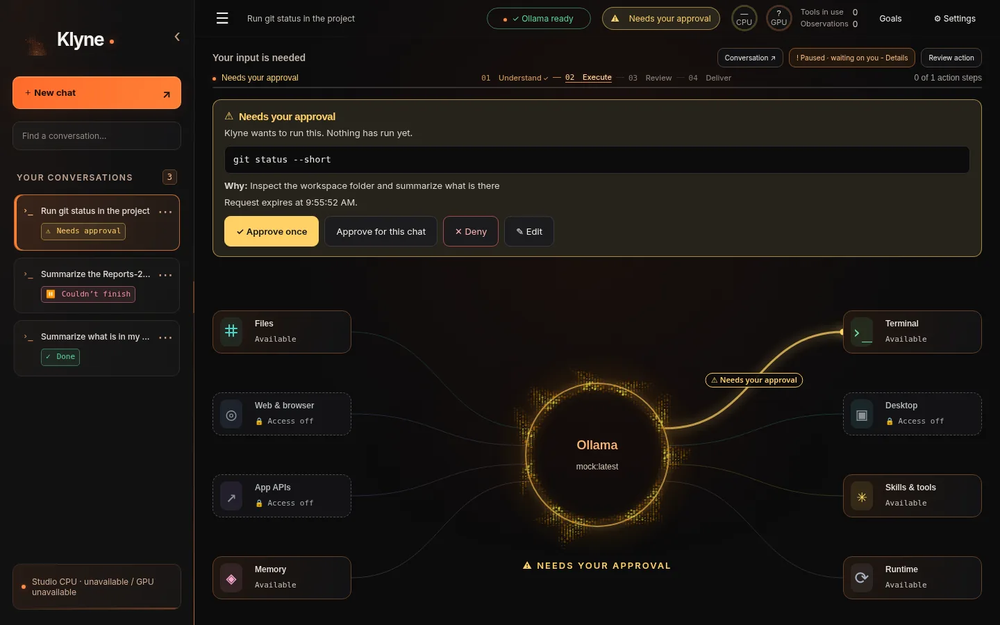
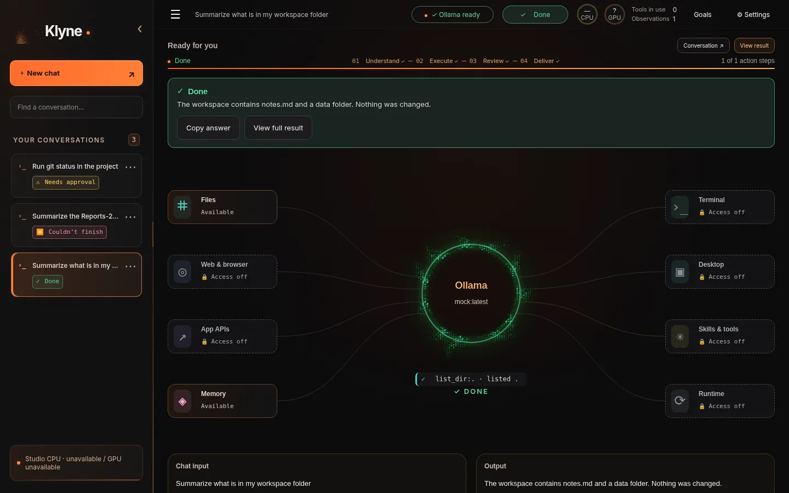
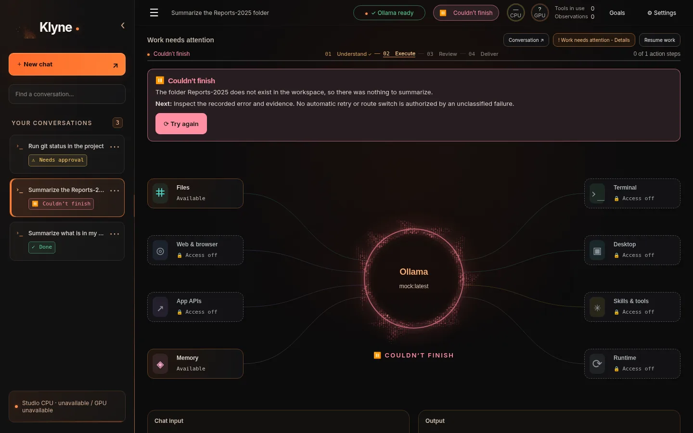
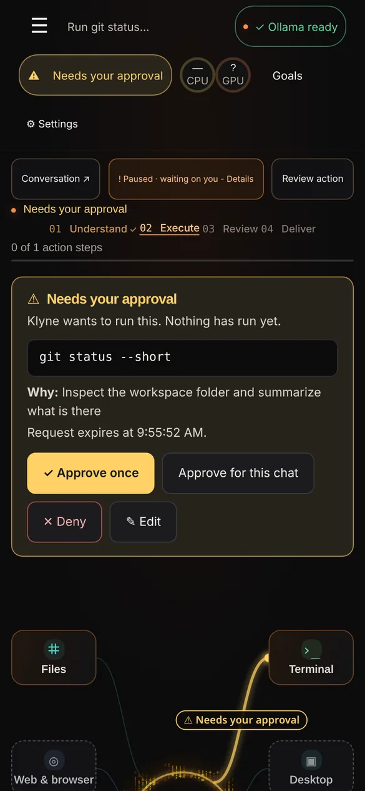
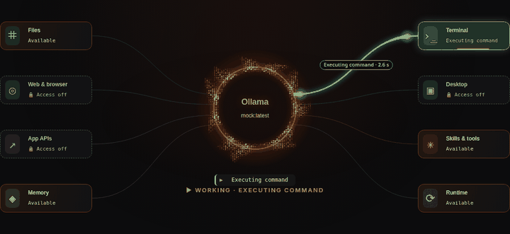

# Klyne

**A local agent harness for small models. Give it a task, watch it work, check the evidence.**

Klyne runs AI agents on your own computer with [Ollama](https://ollama.com). The default model is `qwen3.5:9b`. A planner breaks the request into tasks, a worker acts through native tool calls, and an independent reviewer checks the result against recorded evidence before anything is marked done. The host, not the model, owns execution, permissions, approvals and those checks. Klyne is written in Rust and has a browser interface.



### [Open the interactive demo](https://isaacnewtonne.github.io/Klyne/)

The demo uses the real presentation code with simulated task data. It makes no model calls and cannot access your computer.

## Key features

- **Native tool calls with a compact mode.** The worker and reviewer use Ollama's native `tools` and `tool_calls`. Ollama models of 14B or fewer automatically get compact mode: short prompts, a clipped context and the core tools, with more groups on demand through `enable_tools`. Prose is never executed, and refusals or empty promises are retried instead of shown as answers.
- **An approval queue that confirms before destructive actions.** Deletes, overwrites, destructive shell commands, self-update activation and send, buy, post or submit clicks pause with **Approve once**, **Approve for this chat** or **Deny**. Approvals bind to the exact action, expire after 15 minutes, and survive a restart. Independent tasks keep running while one waits.
- **Evidence-based completion.** File writes get destination-bound receipts with one normalized path key, so `summary.txt`, `.\summary.txt` and `\\?\C:\...\summary.txt` match. Claims in the answer are checked against that evidence. The click/interaction gate refuses "I clicked it" without a real click that changed the page, and refuses page titles taken from the page before the click. Read and summarize requests are answered in chat instead of writing files nobody asked for.
- **Fetch-first web.** Links are read with `fetch_url` before a browser opens. Failures retry through the Jina Reader fallback. GitHub repos, issues and pull requests go through the GitHub API, and YouTube links return metadata plus a transcript. `video_transcript` uses a checksum-verified, local `yt-dlp`. Failures are typed (`NEED_LOGIN`, `RATE_LIMITED`, `PLATFORM_BLOCKED`, `NOT_FOUND`, `NETWORK`) with a hint, and blocked sources are not refetched. Klyne uses no cookies, no logged-in scraping and no stealth browser.
- **Desktop control safety.** Desktop and app access are off until you turn them on. Typing into password fields is refused, focus and field checks run before input, consequential clicks wait for approval, and app results are inspected at the destination with read-only tools. Using your real Chrome is opt-in, and cookies and saved passwords are never read.
- **Loop, stall and turn-end guards.** Repeated identical calls, repeated failures, no-action replies and near-identical answers first get a warning, then a handoff to the reviewer, then a stop with **Needs input** and a reason. If nothing progresses, the UI shows "Still working" after 3 minutes and pauses to ask after 8. Running out of steps is a pause ("the task is NOT done"), never Done. A request to save or change something can't finish on a description alone: the next step must call the tool.
- **A context window sized for 16k.** History is filled newest-first within a token budget and the latest exchange is kept whole. Older tool activity becomes one-line traces, and warnings and memory go in a separate system block. Small models get only the tool groups the request mentions (memory, skills, desktop, video, documents…), and `enable_tools` still adds more.
- **Auto-memory you can see.** After a completed task, one small call to the worker model can note durable preferences from your own words, at most 5 changes and usually none. Secrets and identity data are filtered out. Beliefs carry support counts and a confidence that decays over time, and you can retire them under **Settings → What Klyne remembers about you**. Turn it off with `"auto_memory": false`.
- **Models per role.** Choose a different installed Ollama model for the planner, the worker, the reviewer and voice replies under **Settings → Models per role**.
- **A color-coded interface.** The orb in the center takes the run's state color. Connection lines carry each tool call from the orb to its capability card and back. Every state pairs a color with a label and an icon: Ready, Thinking, Working, Needs your approval, Needs your answer, Done, Couldn't finish, Error and Access off. Reduced motion is respected. See [UI colors](docs/UI-COLORS.md).
- **Local voice (optional).** Dictation, spoken conversation and spoken replies run on the CPU. See [voice setup](docs/voice.md).

| Needs your approval | Done, with the ring |
| --- | --- |
|  |  |
| **Couldn't finish, with a stated reason** | **Mobile** |
|  |  |

<details>
<summary>Connection lines in motion (GIF, about 1 MB)</summary>



</details>

All screenshots come from an isolated test root with a mock model.

## Requirements

- Windows 10 or 11 for the full app, including desktop control. The core runtime and the UI checks also run on Linux.
- A current stable Rust toolchain with edition 2024 support. On Windows, use the MSVC toolchain with the Visual Studio C++ build tools.
- [Ollama](https://ollama.com) with a model that fits your hardware. `qwen3.5:9b` is the tested default. On an 8 GB GPU it takes about 6.6 GB at a 16K context.
- Edge or Chrome for the app window and browser tasks. Node/npm is only needed for the curated browser MCP adapter and the UI tests.

## Setup on Windows

```powershell
ollama pull qwen3.5:9b
# Recommended user environment variables for Ollama (restart Ollama afterwards)
setx OLLAMA_KEEP_ALIVE 30m
setx OLLAMA_CONTEXT_LENGTH 16384

git clone https://github.com/IsaacNewtonne/Klyne.git
cd Klyne
cargo build --locked -p klyne-studio --bins
# Optional: yt-dlp for video_transcript, installed into tools/yt-dlp (git-ignored)
powershell -NoProfile -ExecutionPolicy Bypass -File scripts/install-yt-dlp.ps1
# Start Klyne: preloads the model, then opens the app window at http://127.0.0.1:4317
powershell -NoProfile -ExecutionPolicy Bypass -File scripts/start-klyne.ps1
```

`start-klyne.ps1` accepts these options:

- `-WarmModel <name>` picks the model to preload. The default is `$env:KLYNE_WARM_MODEL`, then `qwen3.5:9b`.
- `-NoWarmup` skips the preload.
- `-NoBrowser` runs Klyne as a background server.

To get a `klyne` command, run `scripts/install-command.ps1`. Closing the last Klyne window stops Klyne and the processes it started.

In **Settings**, select Ollama, check the connection, and turn on only the access a task needs: Web, Terminal, Desktop or app APIs. Terminal and Desktop access act on your real computer.

Conversations and runtime data live under `workspace/`, which is git-ignored. No model weights are bundled.

## Configuration

Optional settings live in `workspace/studio/quality/config.json`. Missing keys use the defaults.

```json
{
  "critique": "auto",
  "findings": "auto",
  "checklist": true,
  "fetch_fallback": "jina",
  "auto_memory": true,
  "stall": { "soft_seconds": 180, "hard_seconds": 480 },
  "models": { "planner": null, "worker": null, "reviewer": null, "voice": null },
  "helper": { "enabled": false, "endpoint": "http://127.0.0.1:11434", "model": "<ollama tag>" }
}
```

- `critique` and `findings` (`auto`, `on` or `off`) control extra reviewer passes. `auto` turns them off for compact (14B or smaller) models.
- `fetch_fallback` set to `off` disables the Jina Reader fallback.
- `auto_memory` (on by default) turns belief learning after completed tasks on or off.
- `stall` sets when the UI says "still working" and when Klyne pauses and asks.
- `models` sets the per-role models. The Settings dialog writes this for you.
- `helper` sets an optional second model for `ask_model`. It is off by default.

The details are in [native tools, approvals and web reach](docs/native-tools-2026-10-24.md).

## Development

```powershell
cargo fmt --check -p klyne-studio
cargo clippy -p klyne-studio --all-targets -- -D warnings
cargo test -p klyne-studio --bin klyne-studio -- --test-threads=4
cargo test -p klyne-studio --test chat -- --test-threads=4
npm ci --ignore-scripts; npx playwright install chromium; npm test
```

The test tiers are described in [docs/test-tiers.md](docs/test-tiers.md). Desktop fixture checks run against a disposable window: `powershell -MTA -NoProfile -File scripts/test_desktop_recovery.ps1`. To build the static demo, run `python scripts/build_site.py`.

## Documentation

| Topic | Guide |
| --- | --- |
| Native tools, approvals, web reach, interaction gate, file receipts | [docs/native-tools-2026-10-24.md](docs/native-tools-2026-10-24.md) |
| Loop guard, turn-end verdict, context window, tool groups, auto-memory | [docs/mercury-port-2026-10-25.md](docs/mercury-port-2026-10-25.md) |
| UI colors and states | [docs/UI-COLORS.md](docs/UI-COLORS.md) |
| Workspace and providers | [Studio](docs/studio.md) · [Providers](docs/studio-providers.md) |
| Policy, approvals and budgets | [Shared execution policy](docs/shared-policy-and-approvals.md) |
| App integrations | [MCP and desktop routes](docs/app-connections.md) |
| Recovery | [Recovery service](docs/recovery.md) |
| Voice | [Setup, use and limits](docs/voice.md) |
| Audits | [2026-09 audit](AUDIT-2026-09-13.md) · [Instruction reliability](docs/audit-2026-10-01.md) |
| Core runtime | [Harness overview](docs/harness-overview.md) |

## Status and limits

Klyne is under active development. Small models still wander: the reviewer and the gates catch false completions, but they cannot make a weak plan efficient. Some limits are known:

- `desktop_type` (typing text) is not gated by approval yet.
- Whether a request is read-only is decided by a word heuristic.
- Supervised processes are lifetime-managed, not sandboxed.

## Credits

- [Agent-Reach](https://github.com/Panniantong/Agent-Reach) (MIT) inspired the web-reach design: reader fallback, GitHub and YouTube routing, transcripts and typed errors. Klyne reimplements these ideas natively in Rust and does not depend on it.
- [Mercury Agent](https://github.com/cosmicstack-labs/mercury-agent) (MIT) inspired the loop and stall detection, the turn-end verdict, the token-budgeted context window, automatic tool groups and auto-memory. Klyne reimplements these ideas natively in Rust and does not depend on it. See [the port notes](docs/mercury-port-2026-10-25.md).
- Klyne builds on [Ollama](https://ollama.com), [Jina Reader](https://jina.ai/reader) (an optional fallback), [yt-dlp](https://github.com/yt-dlp/yt-dlp) (installed separately), the GitHub REST API, and Moonshine and Kokoro for local voice.
